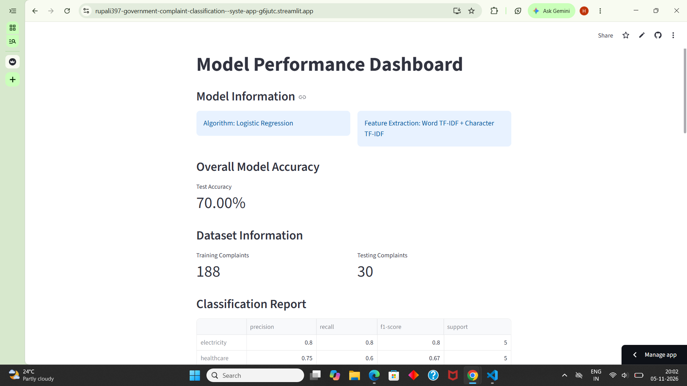
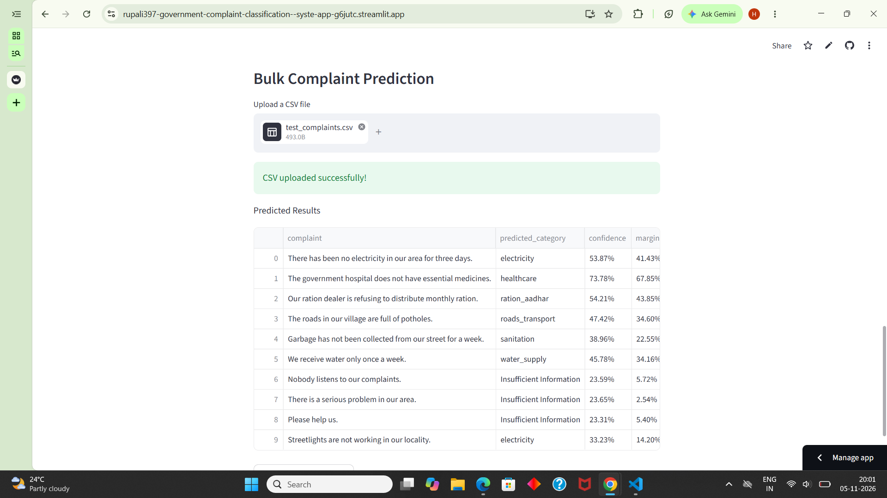
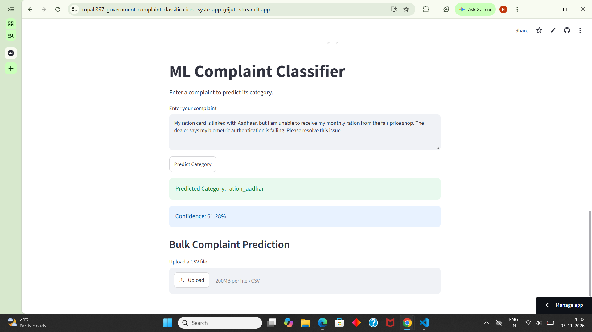

# Government Complaint Classification System

An ML-powered application that automatically classifies government complaints into different categories using Natural Language Processing (NLP) and Machine Learning.

## Live Demo

[Open Government Complaint Classification App](https://government-complaint-classifier.streamlit.app/)

## GitHub Repository

[View Source Code on GitHub](https://github.com/rupali397/Government-Complaint-Classification--System)

## 1. Project Overview

The Government Complaint Classification System helps categorize citizen complaints automatically. Users can enter an individual complaint or upload a CSV file containing multiple complaints to get predictions.

## 2. Problem Statement

Government departments receive complaints related to different public services. Manually categorizing these complaints can be time-consuming.

This project uses Machine Learning to predict the appropriate complaint category from complaint text.

## 3. Technologies Used

- Python
- Pandas
- NumPy
- Scikit-learn
- Natural Language Processing (NLP)
- Word TF-IDF and Character TF-IDF
- Logistic Regression
- Streamlit
- Matplotlib
- Joblib

## 4. Complaint Categories

The model supports six categories:

- Electricity
- Healthcare
- Ration and Aadhaar
- Roads and Transport
- Sanitation
- Water Supply

The dataset contains complaints in English and Hindi.

## 5. Machine Learning Workflow

1. Load and prepare the complaint dataset.
2. Clean and process complaint text.
3. Extract text features using Word TF-IDF and Character TF-IDF.
4. Train and evaluate multiple ML classifiers.
5. Select Logistic Regression as the final model.
6. Save the trained model using Joblib.
7. Deploy the application using Streamlit.

## 6. Model Performance

| Metric | Result |
|---|---:|
| Training Samples | 188 |
| Testing Samples | 30 |
| Test Accuracy | 70.00% |
| Correct Predictions | 21 / 30 |

**Note:** The reported accuracy is based on a test set of 30 complaints. Performance on real-world complaints may differ.

## 7. Application Features

- Single Complaint Classification
- Bulk Complaint Classification through CSV Upload
- Downloadable Prediction Results
- Model Performance Dashboard
- Classification Report
- Confusion Matrix Heatmap
- Insufficient Information Detection

## 8. Application Screenshots

### Home - Single Complaint Prediction


### Bulk CSV Prediction


### Model Performance Dashboard


## 9. Project Structure

```text
Government_Complaints_Dataset/
│
├── app.py
├── README.md
├── requirements.txt
├── .gitignore
│
├── src/
│   ├── train_model.py
│   ├── analyze.py
│   ├── combine_dataset.py
│   ├── predict_complaint.py
│   └── predict_csv.py
│
└── models/
    ├── complaint_classifier.joblib
    └── evaluation_results.joblib
```

## 10. Installation and Setup

Clone the repository:

```bash
git clone https://github.com/rupali397/Government-Complaint-Classification--System.git
```

Navigate to the project folder:

```bash
cd Government-Complaint-Classification--System
```

Install dependencies:

```bash
pip install -r requirements.txt
```

Run the application:

```bash
python -m streamlit run app.py
```

The application will open in your web browser.

## 11. Future Improvements

- Increase dataset size and diversity.
- Improve Hindi and Hinglish complaint classification.
- Explore advanced NLP and transformer-based models.
- Improve model accuracy through systematic experimentation.
- Test performance on unseen real-world complaints.

## 12. Project Status

**Status:** Deployed ML application with single and bulk prediction features and a performance dashboard.

---

Developed as a Machine Learning and NLP learning project.